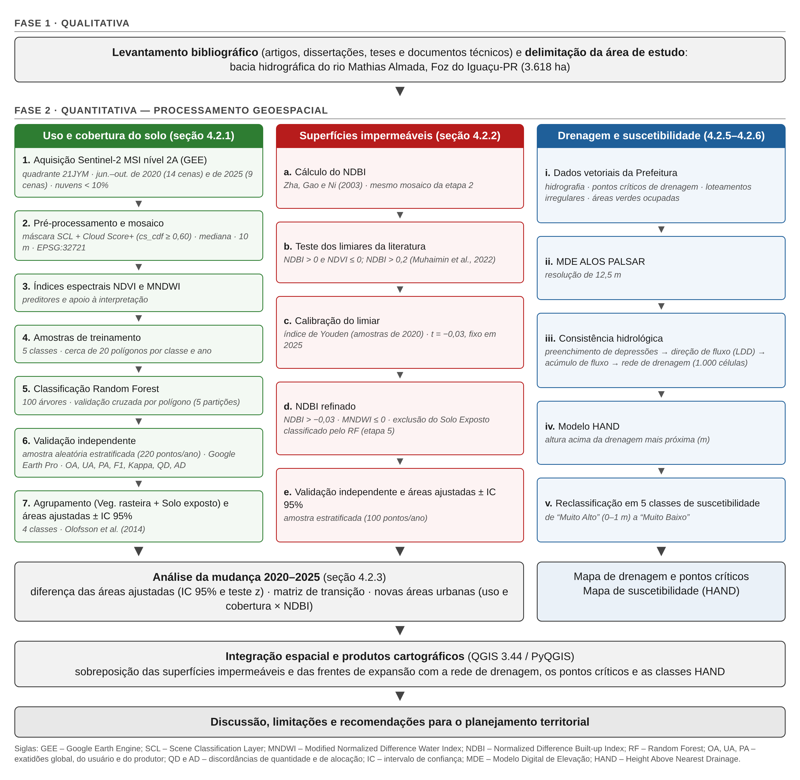

# Uso e cobertura da terra e expansão urbana na bacia do rio Mathias Almada (Foz do Iguaçu, PR), 2020–2025

[](https://doi.org/10.5281/zenodo.24286156)

Scripts e resultados do mapeamento do uso e cobertura da terra (LULC) e da superfície construída (NDBI) na bacia hidrográfica do rio Mathias Almada, em Foz do Iguaçu (PR), para 2020 e 2025. O trabalho usa Sentinel-2 e Random Forest no Google Earth Engine (GEE), e a validação segue o protocolo de boas práticas de Olofsson et al. (2014). Também há scripts PyQGIS que geram a análise de mudança 2020→2025, a suscetibilidade a inundações (HAND) e os mapas finais.

> Trabalho de Conclusão de Curso (TCC), Geografia. Autor: **Renesky Jean Mary**.



## O que há neste repositório

```
gee/
  2020/  Parte1_Mosaico_2020.js   mosaico Sentinel-2 + NDVI, MNDWI, NDBI
         Parte2_MAPEAR_2020.js    Random Forest, validação cruzada, calibração do NDBI, sorteio dos pontos
         Parte3_VALIDAR_2020.js   acurácia e áreas ajustadas (Olofsson et al., 2014)
  2025/  (mesmo fluxo para 2025)
qgis/
  mapas_lulc_ndbi.py              transições LULC, novas áreas urbanas e layouts dos mapas
  mapa_localizacao.py             mapa de localização em três painéis
  mapa_declividade_hipsometria.py declividade (classes Embrapa) e hipsometria
  hand_recalculo.py               HAND (priority-flood, D8, acúmulo, drenagem)
  mapa_hand.py                    mapa de suscetibilidade a inundações (HAND)
resultados/
  2020/, 2025/                    tabelas de validação (T1–T9), pontos de referência rotulados,
                                  cenas usadas, calibração do limiar do NDBI
  *.csv                           matriz de transição, novas áreas urbanas, declividade, HAND
docs/figuras/                     fluxograma e mapa de transições
```

## Métodos em resumo

| Etapa | Detalhes |
|---|---|
| Imagens | Sentinel-2 L2A (`COPERNICUS/S2_SR_HARMONIZED`), mosaico de mediana de 1º/06 a 31/10 de cada ano, cenas com nuvem ≤ 10%, máscara SCL + Cloud Score+ (`cs_cdf` ≥ 0,60) |
| Variáveis | B2, B3, B4, B8, B11, B12, NDVI, MNDWI, NDBI |
| Classificação | Random Forest (`smileRandomForest`), 5 classes, agrupadas em 4 para o resultado final (vegetação rasteira + solo exposto) |
| NDBI | limiares da literatura (Muhaimin et al., 2022; Otsu) e limiar calibrado com as amostras (2020 = −0,03, reaplicado em 2025) |
| Validação | amostragem estratificada, pontos interpretados às cegas no Google Earth Pro; acurácias e áreas ajustadas com IC 95% (Olofsson et al., 2014) |
| Projeção | WGS 84 / UTM 21S (EPSG:32721), 10 m |
| Relevo e HAND | MDE ALOS PALSAR 12,5 m com margem para evitar efeito de borda |

## Como usar

### Google Earth Engine
1. Crie um projeto no GEE e suba o limite da bacia como asset.
2. Em cada script, troque `ASSET_BASE = 'projects/SEU-PROJETO-GEE/assets/'` pelo seu projeto.
3. Importe o limite como `table`. Na Parte 2, importe também os polígonos de treino (`vegDensa`, `vegRasteira`, `agua`, `soloExposto`, `areaUrbana`).
4. Rode a Parte 1, depois a Parte 2. Rotule os pontos sorteados, suba os CSV como assets e rode a Parte 3.
5. Para reproduzir exatamente o mosaico, preencha `CENAS_FIXAS` com os IDs de `resultados/<ano>/05_Metadados_imagens/`.

### QGIS (PyQGIS)
Os scripts rodam no **Terminal Python do QGIS** (testados no QGIS 3.x) com o projeto e as camadas abertos:

```python
exec(open(r'C:\CAMINHO\PARA\mapa_hand.py', encoding='utf-8').read())
```

Antes de rodar, ajuste no início de cada script as variáveis `BASE` (pasta dos dados) e `DEM` (MDE).

## Dados que não estão aqui

Os rasters (mosaicos, classificações, NDBI, MDE e HAND) ficam fora do repositório por causa do tamanho. Eles podem ser gerados de novo com os scripts. O MDE ALOS PALSAR está disponível no [ASF DAAC](https://search.asf.alaska.edu/). Os limites e a hidrografia vêm de bases públicas (IBGE e IAT-PR).

## Formato das tabelas

CSV em UTF-8 com BOM, separador ponto e vírgula e vírgula decimal (abrem direto no Excel em português).

## Referências principais

- Olofsson, P. et al. (2014). Good practices for estimating area and assessing accuracy of land change. *Remote Sensing of Environment*, 148, 42–57.
- Zha, Y.; Gao, J.; Ni, S. (2003). Use of normalized difference built-up index in automatically mapping urban areas from TM imagery. *International Journal of Remote Sensing*, 24(3), 583–594.
- Muhaimin, M. et al. (2022). Mapping build-up area density using NDBI and UI wetland in the city Banjarmasin. *IOP Conf. Ser.: Earth Environ. Sci.*, 1089, 012036.
- Xu, H. (2006). Modification of normalised difference water index (NDWI) to enhance open water features in remotely sensed imagery. *International Journal of Remote Sensing*, 27(14), 3025–3033.
- Otsu, N. (1979). A threshold selection method from gray-level histograms. *IEEE Trans. Systems, Man, and Cybernetics*, 9(1), 62–66.

A lista completa de referências está no fim de cada script.

## Como citar

Jean Mary, R. (2026). *Uso e cobertura da terra e expansão urbana na bacia do rio Mathias Almada (Foz do Iguaçu, PR), 2020–2025: scripts GEE e PyQGIS* (v1.0.0). Zenodo. https://doi.org/10.5281/zenodo.24286156

O botão **"Cite this repository"** do GitHub também gera a citação em APA e BibTeX.

## Licença

- **Código** (`gee/`, `qgis/`): licença [MIT](LICENSE).
- **Tabelas e figuras** (`resultados/`, `docs/`): [CC BY 4.0](https://creativecommons.org/licenses/by/4.0/deed.pt_BR). Pode usar à vontade, desde que cite a fonte.
